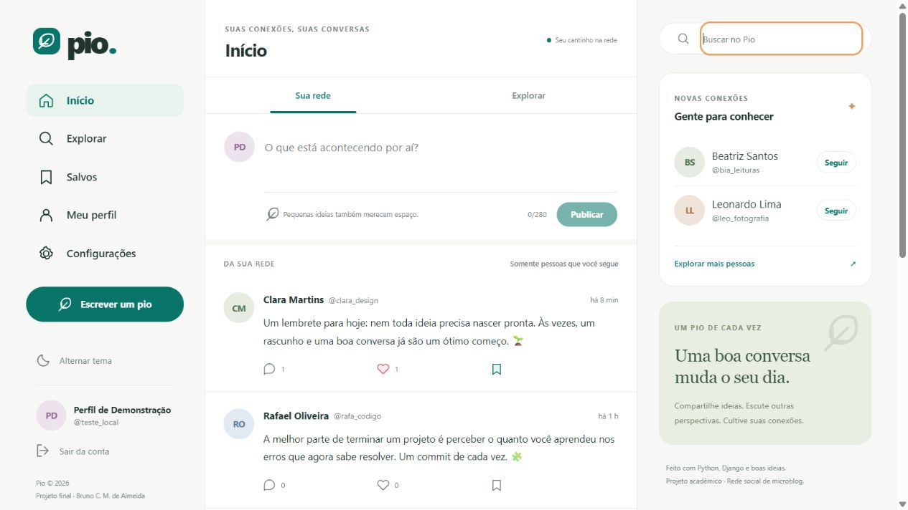

# Pio · Rede social de microblog

Projeto final do curso de Desenvolvimento Full Stack Python da EBAC.

Desenvolvi uma rede social inspirada no funcionamento do Twitter, com identidade visual própria, API REST e interface integrada ao Django. O projeto permite criar uma conta, personalizar o perfil, publicar ideias e construir uma rede de conexões.



[Visualizar a interface móvel no modo escuro](docs/images/feed-mobile-dark.jpg)

## Aplicação online

Acesse: https://brunom.pythonanywhere.com/

Para experimentar, crie uma conta, abra Explorar e siga os
perfis demonstrativos. O feed Início exibirá as publicações
das pessoas seguidas.

É possível publicar, editar e excluir suas publicações,
curtir, comentar, salvar posts e personalizar o perfil.

## Funcionalidades

| Requisito | Implementação |
|---|---|
| Cadastro e login | Conta com usuário, nome, e-mail e senha; autenticação por sessão e proteção CSRF |
| Perfil | Nome, biografia e foto editáveis separadamente; troca de senha independente |
| Seguir pessoas | Seguir/deixar de seguir, contadores e listas paginadas de seguidores e seguidos |
| Feed exclusivo | A página Início mostra **somente publicações das pessoas seguidas**, sem incluir posts próprios ou de desconhecidos |
| CRUD de publicações | Criar, consultar, editar e excluir publicações de até 280 caracteres; edição e exclusão restritas ao autor |
| Interações | Curtir/descurtir, listar, criar, editar e excluir comentários; somente o autor altera seu comentário |
| API REST | Endpoints JSON para todos os fluxos principais da interface |
| Hospedagem | Configuração para PythonAnywhere com SQLite persistente, HTTPS, WhiteNoise e fotos em `/media/` |

Acrescentei busca por pessoas e publicações, aba Explorar, posts salvos privados, modo claro/escuro, contador de caracteres, paginação, sugestões de pessoas e uma interface responsiva com navegação por teclado.

O feed **Início** e a aba **Explorar** têm funções diferentes: o primeiro respeita estritamente os relacionamentos de seguir; a segunda mostra as publicações de todos os usuários ativos. Ao publicar, a interface abre o perfil do autor, onde seu próprio post está disponível.

## Tecnologias e organização

- Python, Django 5.2 e Django REST Framework.
- Templates Django, CSS e JavaScript modular; as interações utilizam a API com `fetch`.
- SQLite, adequado à demonstração acadêmica e à hospedagem gratuita.
- Pillow para validar e converter fotos de perfil para JPEG de 512 × 512 pixels.
- WhiteNoise para os estáticos, Docker Compose para execução local e GitHub Actions para integração contínua.

```text
config/                       Configuração, rotas e WSGI
social/models.py              Usuários, publicações e relacionamentos
social/serializers.py          Validação de entrada e representação da API
social/views.py               Endpoints e permissões
social/tests/                 Testes automatizados
social/management/commands/    Dados demonstrativos
templates/                    Interface integrada
static/                       CSS, JavaScript e identidade visual
deploy/                       Configuração da hospedagem
.github/workflows/ci.yml       Verificações e testes no GitHub
```

## Executar no Windows com Docker

Pré-requisito: Docker Desktop iniciado. Extraia o projeto e abra a pasta `md-final-pio` no VS Code. Execute no PowerShell dessa pasta:

```powershell
docker compose up -d --build --wait
docker compose ps
docker compose exec web python manage.py seed_demo
```

Acesse **http://127.0.0.1:8005/** e clique em **Criar uma conta**. Cadastre seu próprio usuário, nome, e-mail e uma senha de pelo menos 10 caracteres. Depois abra **Explorar**, siga algumas pessoas e volte para **Início**.

O comando `seed_demo` cria 4 perfis fictícios e 12 publicações. Ele pode ser repetido sem duplicar esses registros. As contas demonstrativas possuem senha inutilizável e não permitem login; o visitante cria uma conta própria para experimentar os recursos.

O administrador é opcional e separado das contas comuns:

```powershell
docker compose exec web python manage.py createsuperuser
```

Acesse http://127.0.0.1:8005/admin/ para administração. As contas comuns não precisam de privilégios administrativos para utilizar a rede social.

### Dados e reinicialização

O banco e as fotos ficam nos volumes `pio_data` e `pio_media`. Para parar e iniciar preservando os dados:

```powershell
docker compose down
docker compose up -d --wait
```

`docker compose down -v` remove esses volumes e seus dados. Para personalizar a porta local, copie `.env.example` para `.env` e ajuste `APP_PORT` antes de iniciar os serviços.

## Executar sem Docker

Com Python 3.10 ou posterior, no PowerShell:

```powershell
python -m venv .venv
.\.venv\Scripts\python.exe -m pip install -r requirements.txt
.\.venv\Scripts\python.exe manage.py migrate
.\.venv\Scripts\python.exe manage.py seed_demo
.\.venv\Scripts\python.exe manage.py runserver 127.0.0.1:8005
```

Nesse modo, os dados ficam em `data/db.sqlite3` e as fotos em `media/`. O servidor de desenvolvimento serve apenas para execução local; no PythonAnywhere, a aplicação usa WSGI.

## Testes e integração contínua

```powershell
docker compose exec -T web python manage.py check
docker compose exec -T web python manage.py makemigrations --check --dry-run
docker compose exec -T web python manage.py test --verbosity 2
```

A suíte contém 67 testes e passou no ambiente Docker Linux. Os testes usam um banco temporário e não alteram os cadastros da aplicação. Há verificações de CSRF inclusive no login anônimo, autenticação, senhas, isolamento entre contas, feed exclusivo, relações idempotentes, integridade do banco, contadores, paginação, fotos, dados privados e rotas da interface.

O workflow executa em pushes e pull requests. Ele constrói a imagem, verifica o Django, confere migrações, executa os testes e valida a coleta de estáticos com DEBUG desativado. Esse workflow realiza integração contínua; a publicação inicial na hospedagem é configurada separadamente.

## API REST

Todas as rotas privadas exigem uma sessão autenticada. A interface obtém o cookie CSRF e envia `X-CSRFToken` nas operações de escrita. Não há credenciais em `localStorage`; apenas a preferência de tema é armazenada localmente.

| Método | Endpoint | Finalidade |
|---|---|---|
| GET | `/api/auth/csrf/` | Obter cookie/token CSRF |
| POST | `/api/auth/register/` | Criar conta e iniciar sessão |
| POST | `/api/auth/login/` | Iniciar sessão |
| POST | `/api/auth/logout/` | Encerrar sessão |
| GET, PATCH | `/api/me/` | Consultar/editar o próprio perfil |
| POST | `/api/me/password/` | Trocar senha com confirmação da senha atual |
| GET | `/api/users/?search=texto` | Buscar pessoas |
| GET | `/api/users/{username}/` | Consultar perfil público para usuários autenticados |
| GET | `/api/users/{username}/followers/` | Listar seguidores |
| GET | `/api/users/{username}/following/` | Listar seguidos |
| GET | `/api/users/suggestions/` | Sugerir pessoas ainda não seguidas |
| PUT, DELETE | `/api/users/{username}/follow/` | Seguir/deixar de seguir, sem duplicação |
| GET, POST | `/api/posts/` | Explorar/criar publicações |
| GET | `/api/posts/?author=username` | Listar publicações de um perfil |
| GET | `/api/posts/?search=texto` | Buscar publicações |
| GET | `/api/posts/feed/` | Feed exclusivo de seguidos |
| GET, PUT, PATCH, DELETE | `/api/posts/{id}/` | Consultar/editar/excluir uma publicação |
| PUT, DELETE | `/api/posts/{id}/like/` | Curtir/descurtir |
| PUT, DELETE | `/api/posts/{id}/bookmark/` | Salvar/remover dos salvos |
| GET | `/api/posts/saved/` | Consultar apenas os próprios salvos |
| GET, POST | `/api/posts/{id}/comments/` | Listar/criar comentários |
| GET, PUT, PATCH, DELETE | `/api/comments/{id}/` | Consultar/editar/excluir comentário |

As listas seguem o formato `count`, `next`, `previous` e `results`, com 15 registros por página. Operações idempotentes usam PUT/DELETE: repetir uma curtida ou um follow não duplica registros.

Exemplo de publicação, após autenticação e obtenção do CSRF:

```json
{"content": "Compartilhando meu primeiro projeto completo com Django!"}
```

PATCH `/api/me/` aceita apenas `name`, `bio`, `avatar` e `remove_avatar`. Todos são opcionais; `{}` preserva o perfil. Para fotos use `multipart/form-data`. A senha é alterada separadamente em `/api/me/password/` com `current_password`, `new_password` e `password_confirm`.

E-mails, hashes de senha e flags administrativas não são expostos nos perfis. Textos de usuários são renderizados com `textContent`, sem interpretação de HTML. Uploads aceitam JPEG, PNG e WebP até 2 MB e 16 megapixels; o servidor reencoda a imagem e usa um nome aleatório. O login e o cadastro têm limitação de tentativas. A troca de senha preserva a sessão atual e invalida as demais.

## Hospedagem no PythonAnywhere

Use uma conta separada para este projeto caso a conta existente já hospede o Bookstore do MD23. O plano gratuito oferece um aplicativo por conta. Não é necessário excluir o projeto anterior.

### Instalação no console Bash

Com o código enviado ao seu repositório GitHub público, abra o Bash da conta destinada ao Pio. Substitua a URL de exemplo pela URL real do repositório:

```bash
cd ~
git clone https://github.com/SEU_USUARIO/md-final-pio.git
cd md-final-pio
python3.10 -m venv ~/venv-pio
source ~/venv-pio/bin/activate
pip install --no-cache-dir -r requirements.txt
python deploy/configure_pythonanywhere.py
python manage.py migrate
python manage.py seed_demo
python manage.py collectstatic --noinput
python manage.py check
```

Use a versão de Python disponível na conta e selecione a mesma versão no Web app. O script preserva um `.env` já existente, gera uma chave privada e utiliza o usuário real nos caminhos, normalizando apenas o domínio para minúsculas. Caso o domínio seja diferente do padrão, use `--domain ENDERECO.pythonanywhere.com`.

### Configuração na aba Web

Crie um aplicativo em **Manual configuration**, com a mesma versão de Python do ambiente virtual. O script mostra os caminhos exatos:

- **Source code e Working directory:** `/home/SEU_USUARIO/md-final-pio`.
- **Virtualenv:** `/home/SEU_USUARIO/venv-pio`.
- **WSGI configuration file:** substitua seu conteúdo pelo arquivo `.hosting/pythonanywhere_wsgi.py` gerado no projeto. Visualize com `cat .hosting/pythonanywhere_wsgi.py`.
- **Static files:** cadastre URL `/media/` apontando para `/home/SEU_USUARIO/md-final-pio/media`. Esse mapeamento é necessário para as fotos dos usuários. CSS e JavaScript são servidos pelo WhiteNoise.

Clique em **Reload** e abra `https://SEU_USUARIO.pythonanywhere.com/`. Cadastre sua conta pela interface, siga os perfis demonstrativos e confira os recursos. O banco da hospedagem é independente do banco local.

Os caminhos Linux começam com `/home/`; traduções automáticas do navegador podem alterar apenas a apresentação do texto. Preencha os caminhos reais. O domínio usa minúsculas, mas preserve as maiúsculas do usuário nos caminhos de arquivo.

### Atualizar uma publicação já instalada

Depois de revisar e mesclar alterações no GitHub, no Bash da hospedagem:

```bash
cd ~/md-final-pio
source ~/venv-pio/bin/activate
git pull --ff-only origin main
pip install --no-cache-dir -r requirements.txt
python manage.py migrate
python manage.py collectstatic --noinput
```

Clique em **Reload** na aba Web. O banco em `data/`, as fotos em `media/` e o `.env` não fazem parte do Git. Faça backup do banco e das fotos antes de alterações na hospedagem. Contas gratuitas precisam de renovação periódica pelo painel, conforme a data de validade exibida no PythonAnywhere.

## Entrega

Entrego o código-fonte no GitHub com este README e o endereço público da aplicação. Após a publicação, incluo o link real do deploy na descrição do repositório e no PR da entrega. As evidências mostram cadastro/login, edição independente de perfil, feed de seguidos, listas de relacionamentos, publicações, curtidas, comentários e testes aprovados.

O projeto é uma demonstração acadêmica funcional. Não inclui envio de e-mails de verificação, recuperação de senha por e-mail ou moderação automatizada. O banco SQLite e o limitador de tentativas em memória atendem ao ambiente de demonstração; uma implantação de maior escala exige banco e cache compartilhados, política de moderação e monitoramento.

## Autor

Bruno Costa Macedo de Almeida
